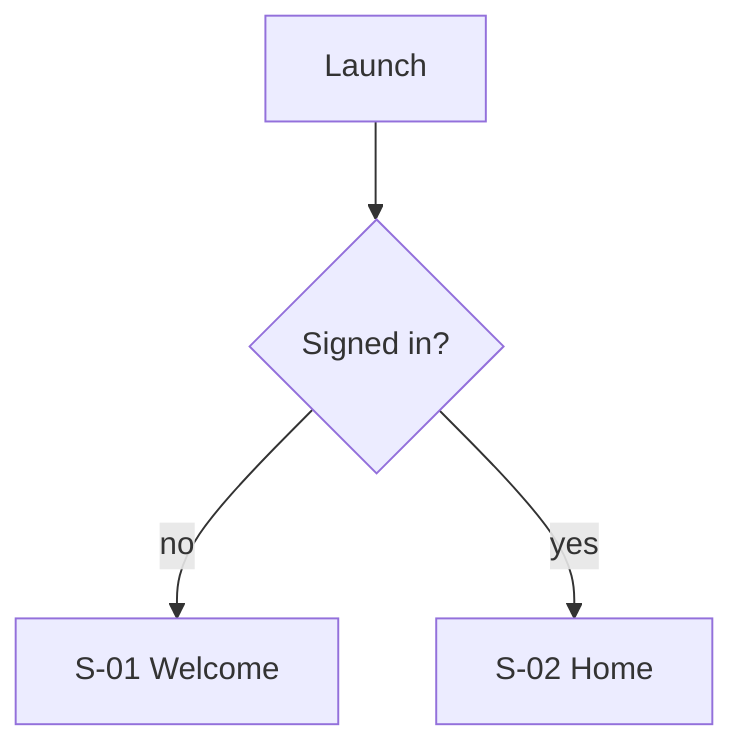

# 04. App flow

<!-- How the user moves through the product, step by step. Each step names a screen (S-xx) and the data it touches. -->

## F-01 Launch and first run

1. <Step: what the user sees (screen), does, and what happens (data, request).>

## F-02 Sign-in, sign-out and account

## F-03 Onboarding

## F-04 <Main daily flow>

## F-05 <Each feature flow>

## F-xx Errors and edge cases
<Offline, expired session, permission denied, empty data, slow network, conflicting edits.>

## F-xx Settings, export and account deletion

## F-xx Notifications and background work
